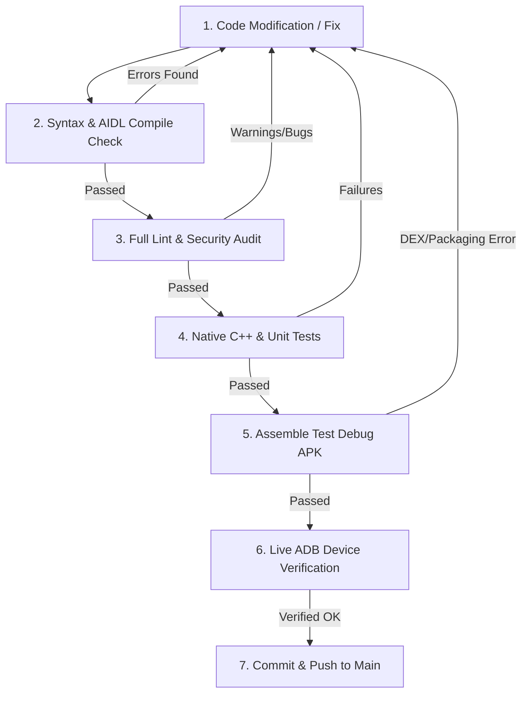

# Clean Build & Code Verification Pipeline — Game Launcher

Gabay at standard operating procedure (SOP) sa tamang proseso ng pag-develop, pag-debug, pag-lint, at pag-build ng Game Launcher Android application.

Sundin ang 6-stage verification pipeline na ito sa tuwing may binabago o inaayos na code bago gawin ang opisyal na release build o pag-push sa repository.

---

## 📋 Ang 6-Stage Clean Build Workflow



---

## 🛠️ Hakbang-hakbang na Proseso

### Hakbang 1: Pre-Build Syntax & AIDL Compile Check
Bago mag-aksaya ng oras sa buong packaging, i-verify muna ang Java sources at AIDL interfaces. Agad nitong inilalabas ang mga compilation errors, missing symbols, at type mismatches.

```bash
cd android
./gradlew compileDebugJavaWithJavac
```
- **Ano ang inaasahan:** `BUILD SUCCESSFUL` na may 0 errors.
- **Kung may error:** Ayusin agad ang linya at method signatures na tinutukoy ng javac bago magpatuloy sa susunod na hakbang.

---

### Hakbang 2: Full Lint Audit & Static Analysis
Sinasala ng Lint ang mga nakatagong bugs na hindi nakikita ng regular compiler, gaya ng:
- Obsolete SDK version guards (dahil ang `minSdk` ng launcher ay 34 / Android 14+).
- Unclosed file descriptors, streams, at leaked background processes.
- Memory leaks sa Views at Context listeners.
- Risky cross-UID file permissions (`SetWorldReadable` / `SetWorldWritable`).
- Manifest conflicts at navigation inconsistencies.

```bash
cd android
./gradlew lintDebug
```
- **Tingnan ang resulta sa Terminal o i-parse ang SARIF report:**
```bash
python3 -c "
import json
with open('android/app/build/reports/lint-results-debug.sarif') as f:
    d = json.load(f)
for r in d.get('runs', []):
    results = r.get('results', [])
    print(f'Total Lint Issues: {len(results)}')
    for res in results:
        rule = res.get('ruleId', 'unknown')
        msg = res.get('message', {}).get('text', '')
        loc = res.get('locations', [{}])[0].get('physicalLocation', {})
        uri = loc.get('artifactLocation', {}).get('uri', '')
        line = loc.get('region', {}).get('startLine', 0)
        print(f'[{rule}] {uri}:{line} -> {msg}')
"
```
- **Pag-ayos:**
  - Tanggalin ang mga redundant na `if (Build.VERSION.SDK_INT >= Build.VERSION_CODES.O)` dahil laging true ito sa Android 14+.
  - Kung sadyang kailangan ang cross-UID file permission para sa game configs (hal. `/storage/emulated/0/Android/data/...`), lagyan ng explicit suppression annotation:
    `@android.annotation.SuppressLint({"SetWorldReadable", "SetWorldWritable"})` na may documented reason.

---

### Hakbang 3: Native C++ & CMake Compilation Check
Kapag may ginalaw sa native directory (`android/app/src/main/cpp/`), tiyaking nagko-compile ang lahat ng target ABIs (`arm64-v8a`, `armeabi-v7a`, `x86_64`):

```bash
cd android
./gradlew buildCMakeDebug[arm64-v8a]
```
- **Ano ang inaasahan:** Walang header mismatch o missing JNI export symbols.

---

### Hakbang 4: Unit Testing at Regression Check
Patakbuhin ang local unit tests upang matiyak na walang na-regress sa config parsing, memory bridges, o game patchers:

```bash
cd android
./gradlew testDebugUnitTest
```
- **Ano ang inaasahan:** Lahat ng tests ay passed.

---

### Hakbang 5: Buong APK Assembly (`assembleDebug`)
Dito pinagsasama ang DEX bytecode, compiled native libraries (`.so`), processed assets, at AndroidManifest.

```bash
cd android
./gradlew assembleDebug
```
- **Nilikhang Artifact:** `android/app/build/outputs/apk/debug/app-debug.apk`
- **Ano ang inaasahan:** DEX merge successful, 0 duplicate class conflicts.

---

### Hakbang 6: Live Smoke Test sa Device via ADB
I-install at subukan sa konektadong Android device (hal. TECNO CM7 sa Android 16):

```bash
# 1. I-install ang bagong gawang debug APK
adb install -r android/app/build/outputs/apk/debug/app-debug.apk

# 2. Ilunsad ang Main Activity
adb shell am start -n com.gamebooster.app/.ui.activities.MainActivity

# 3. I-verify na buhay ang Shizuku Server at hindi naki-kill
adb shell ps -A | grep -i shizuku

# 4. Magbasa ng logs para sa ANR o uncaught crash exceptions
adb logcat -d -s AndroidRuntime:E GameBooster:V ShizukuDiag:V | tail -n 40
```

---

## ⚡ One-Liner Full Audit Command
Para sa mabilisang automated validation ng buong pipeline sa isang command bago mag-commit:

```bash
cd android && ./gradlew compileDebugJavaWithJavac lintDebug testDebugUnitTest assembleDebug
```

---

## ⚠️ Checklist ng mga Dapat Tandaan sa Code Changes

1. **Shizuku IPC Protection:**
   - Huwag kailanman mag-execute ng `setprop service.adb.tcp.port` o `settings put global adb_wifi_enabled 1` sa background pulse — nagre-restart ito ng `adbd` at pinapatay ang `shizuku_server`.
   - Sa `Shizuku.unbindUserService()`, laging gamitin ang `remove = false` para maiwasang ma-terminate ang background daemon tuwing may network reconnection.
   - Laging i-invoke ang `remoteProcess.destroy()` sa loob ng `finally` block upang maiwasan ang file descriptor leak sa loob ng `shizuku_server`.

2. **Game Config Integrity (MLBB, CODM, PUBG):**
   - Huwag i-overwrite ang buong binary configs (tulad ng `Active.sav` ng PUBG) gamit ang default presets para maiwasang mawala ang login token o ma-stuck sa loading screen.
   - Huwag burahin o i-damage ang `files/contents` manifest ng MLBB at CODM para hindi mag-trigger ng buong 10GB+ in-game re-download.

3. **Android 16 / SDK 36 Compatibility:**
   - Irespeto ang bagong SELinux at phantom process killer policies. Huwag gumamit ng unmanaged hidden reflection sa internal framework classes kung may available na AIDL interface.
